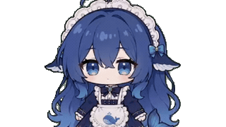
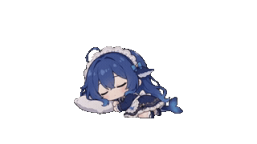

# 大肥鱼桌宠 · dsh-pet 便携版

> 一只住在 Windows 桌面上的蓝发小女仆。免安装，自带 Node + Electron，整个文件夹拷走就能跑。

这是基于 [PC2005-cloud/dsh-pet](https://github.com/PC2005-cloud/dsh-pet) 的**便携版二次开发**，在原版基础上加了心情系统、分部位触摸等功能。

## 下载安装

**[→ 去 Releases 下载完整安装包](https://github.com/lrelyn/dsh-pet-portable/releases/latest)**

```powershell
# 1. 在 Releases 页面下载那个 .zip（约 415 MB，文件名带版本号和时间戳）
# 2. 解压到任意位置（桌面、D 盘、U 盘都行）
# 3. 双击 大肥鱼桌宠.exe
```

> 附件名形如 `-v0.5.0-20261024-1737.zip`——前面的中文在 GitHub 上传时被截掉了，
> 不影响内容。认准版本号和时间戳即可。

| 项 | 要求 |
|---|---|
| 系统 | Windows 10/11 64 位（**Win7/8 不支持**） |
| 磁盘 | 约 1.6 GB（解压后） |
| 其他 | 无需装 Node / Electron / DSH；未签名程序，杀毒软件可能误报需放行 |

**必须整个文件夹一起拷**，只拷 exe 没用。

### 三种使用方式

| 方式 | 命令 | 适合 |
|---|---|---|
| **安装包**（推荐） | 双击 `大肥鱼桌宠.exe` | 普通用户 |
| **源码跑** | `runtime\node.exe app\lib\standalone.js --port 3080` | 开发者，改完立刻看效果 |
| **DSH 插件** | `dsh plugin add dsh-pet` | 想要说话/余额/联动的人（装上游版） |

### 常见问题

**双击没反应？**
看 `pet.log`。首次启动会先试 Chromium 沙箱，失败会自动降级重试，两种情况日志里都写了。

**桌宠出现了但任务栏没有图标？**
正常的，它在系统托盘里。结束它：任务管理器里结束 `electron.exe`。

**想改配置？**
编辑 `data\dsh-pet\main-config.jsonc`（心情阈值、触摸池、动作池、精力/好感度都在里面）。

> ⚠️ 只改这一份。便携版通过 `launcher.js` 把 `DSH_HOME` 指到包内 `data\`，所以 `~\.dsh\dsh-pet\` 那份**完全不参与**——改它不会有任何效果。
> 判断当前读的是哪份：看启动日志里「配置 <路径>」那一行。

**动作太少 / 想自己加动作？**
见下方「自己造动作」。放好的 `.webm` 丢进 `data\dsh-pet\main-animation\webm\` 就行，不用动 `app\assets\` 里的内置素材。

## 效果预览

> 30 张全部统一 320×180、**白底**（GIF 的透明在深色主题下会显示成黑块，所以直接铺白底）。
> 用表格排版，每组都是偶数张、每行 2 张，不会有落单的半格。

### 基础状态

<table>
<tr>
<td></td>
<td></td>
</tr>
<tr>
<td></td>
<td></td>
</tr>
</table>

### 分部位触摸

点她不同部位有不同反应，**连点同一部位还会递进**（害羞 → 开心 → 咯咯笑）

<table>
<tr>
<td></td>
<td></td>
</tr>
<tr>
<td></td>
<td></td>
</tr>
<tr>
<td></td>
<td></td>
</tr>
</table>

### 拖拽与移动

被她不喜欢被拎起来（心情 −4）

<table>
<tr>
<td></td>
<td></td>
</tr>
<tr>
<td></td>
<td></td>
</tr>
</table>

### 睡眠整套

空闲到期后：**躺下 → 呼吸循环 → 醒来**。三段连播才是完整一次睡眠

<table>
<tr>
<td></td>
<td></td>
</tr>
<tr>
<td></td>
<td></td>
</tr>
</table>

### 工作整套

空闲 5 分钟后自己找活干：**开工 → 干活 → 收工**

<table>
<tr>
<td></td>
<td></td>
</tr>
<tr>
<td></td>
<td></td>
</tr>
</table>

### 日常与玩耍

<table>
<tr>
<td></td>
<td></td>
</tr>
<tr>
<td></td>
<td></td>
</tr>
</table>

### 吃喝与时节

节日当天「时节」类的出现权重会变高

<table>
<tr>
<td></td>
<td></td>
</tr>
<tr>
<td></td>
<td></td>
</tr>
</table>

全部动画（640×360，插件实际播放用的资源）见插件包 `dsh-pet/assets/webm/`（VP9-alpha，唯一发布格式）；完整透明视频见上游仓库。

预览图由 `make-preview-gifs.py` 从 `app/assets/webm/` 转出：320×180 / 12fps / 白底，30 张。
（ffmpeg 抽帧 PNG → PIL 合成白底 → GIF。为什么不直接让 ffmpeg 出 GIF：VP9-alpha 的透明区
在 GitHub 深色主题下会显示成黑块，而 ffmpeg 内联铺白底的 6 种方案都读不到正确的 alpha。）

## 和原版有什么不同

| 功能 | 原版 | 这里 |
|---|---|---|
| 心情系统 | 无 | 连续 0~100 心情值，四档（开心/平静/疲倦/烦躁），影响动作选择 |
| 分部位触摸 | 点哪都一样 | 摸头 / 撸身子 / 点脚 → 不同动画池，同部位连点递进 |
| 睡眠/工作守卫 | 素材缺失会静默失效 | 缺素材时跳过该功能，不会把宠物定格 |
| 使用说明 | 纯文本 | 网页版（含赞助码），菜单里直接打开 |
| 免安装 | 需要 DSH 插件 | 自带运行时，双击即用 |

## 目录结构

```
dsh-pet-portable/
├─ app/                         桌宠本体
│  ├─ src/                      源码（shared / host / client / standalone）
│  ├─ lib/                      构建产物
│  ├─ runtime/electron-helper/  ★ 桌面端实际运行的 JS（改了重启即生效）
│  └─ assets/                   配置 + 小图标（webm 素材不在本仓库，见下）
├─ config/                      真正生效的配置快照 + 说明
├─ .gitignore
├─ launcher.js                  启动器源码（沙箱探测 + 降级重试）
├─ pack.ps1                     打包脚本
└─ mood-tune.ps1                心情调参台
```

## 本仓库不包含什么

为了控制体积，以下**不在** git 里（见 `.gitignore`）：

| 排除项 | 体积 | 怎么补 |
|---|---|---|
| `electron/` | 563 MB | 从上游 `npm run ensure:electron` |
| `runtime/node.exe` | 89 MB | 从 nodejs.org 下载 |
| `app/assets/webm/` | 67 MB | 从上游 `assets/webm` 拷贝 |
| `大肥鱼桌宠.exe` | 90 MB | 用 `launcher.js` 重新打包 |

**所以本仓库 clone 下来不能直接运行**，需要补齐运行时和素材。完整步骤见 [my-life-archive 的恢复清单](https://github.com/lrelyn/my-life-archive/blob/main/notes/dsh-pet-restore.md)。

> **只是想像普通用户一样用？** 别折腾这些 —— 直接去 [Releases](https://github.com/lrelyn/dsh-pet-portable/releases/latest) 下打包好的完整版（约 415 MB），解压双击就能跑。

## 自己造动作

原版有一套完整的素材制作管线（绿幕视频 → 透明 webm）：

```
step01 绿幕源视频
  ↓ crop_step01.py        裁切
  ↓ chroma_step02.py      HSV 色相抠像 → 透明
  ↓ normalize_step03.py   归一化统一站位
  ↓ encode_thumbs.py      转 640×360 VP9-alpha
step04 → assets/webm/
```

关键参数：
- 抠像用 **HSV 色相判定**（`GREEN_HUE_MIN=70, GREEN_HUE_MAX=170, SAT_MIN=0.15`），不用 `chromakey` —— 后者会把蓝色/白色误抠
- 转码必须写 `-c:v libvpx-vp9`（输入端也要）和 `format=yuva420p`，否则丢 alpha 变黑底
- 最终规格 **640×360 / VP9 / CRF 40 / 24fps / 无音轨**

原创动作请放 `app/assets/webm-original/`（该目录**会**进 git），部署时复制到 `assets/webm/`。

详细说明见 [架构笔记](https://github.com/lrelyn/my-life-archive/blob/main/notes/dsh-pet-architecture.md)。

## 许可

- **代码**：MIT（继承上游）
- **动画素材**：上游明确「允许开源使用，**禁止商用**」
- 本仓库不含素材文件，素材请从上游获取并遵守其许可

原作者的 LICENSE 完整保留在 `app/LICENSE` 与 `app/LICENSE-dsh-whale-girl-pet`。

## 致谢

- 原作者：[PC2005-cloud](https://github.com/PC2005-cloud) — [dsh-pet](https://github.com/PC2005-cloud/dsh-pet)
- 本便携版的打包与功能扩展由本仓库维护者完成
